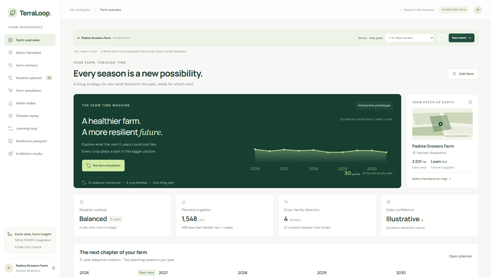
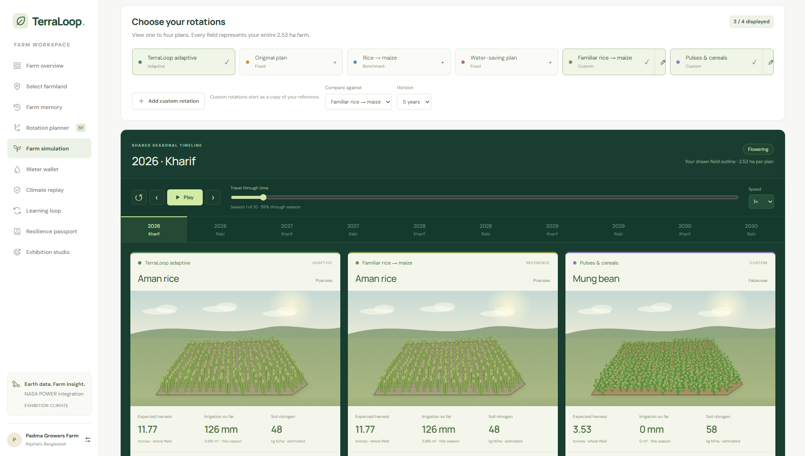

# TerraLoop: The Farm Time Machine
### A Crop-Rotation Decision-Support System for Smallholder Farms

[](https://nodejs.org/)
[](package.json)
[](tests/)
[](https://power.larc.nasa.gov/)
[](dist/vendor/LEAFLET-LICENSE.txt)

> **"A living strategy for your land. Rooted in the past, ready for what’s next."**
> 
> **TerraLoop** is an open-source, runnable agricultural decision-support prototype engineered for smallholder farming communities. Twelve connected views let a farmer record past seasons, generate optimized multi-year rotation plans, simulate climate disruptions, compare strategies side by side, audit NASA Earth observation feeds, and export a portable resilience passport — all inside a single browser tab with zero installation, zero build steps, and zero external runtime dependencies.
>
> Built for the **NASA Space Apps Challenge 2026**.



---

## Table of Contents

- [Quick Start](#quick-start)
- [What TerraLoop Does](#what-terraloop-does)
- [Features & 12 Connected Views](#features--12-connected-views)
- [How the Optimizer Works](#how-the-optimizer-works)
- [Crop Database & Residue Handling](#crop-database--residue-handling)
- [Water Budget Model](#water-budget-model)
- [Nitrogen Balance Model](#nitrogen-balance-model)
- [Soil Health & RUSLE Erosion Model](#soil-health--rusle-erosion-model)
- [Climate Stress and Escape Routes](#climate-stress-and-escape-routes)
- [NASA Earth Observations & Datasets Matrix](#nasa-earth-observations--datasets-matrix)
- [Farm Simulation](#farm-simulation)
- [Architecture](#architecture)
- [Project Structure](#project-structure)
- [Testing & Quality Assurance](#testing--quality-assurance)
- [Data and Model Boundaries](#data-and-model-boundaries)
- [Sources & Scientific References](#sources--scientific-references)
- [Team CyberPookie](#team-cyberpookie)

---

## Quick Start

Requires Node.js (v18+). No dependency installation, no build step, no API keys.

```sh
cd terraloop
node server.mjs
# Open http://127.0.0.1:4173 in any modern browser
```

Or using npm:

```sh
npm run dev
```

Run the automated test suite:

```sh
npm test
# Or directly:
node --test tests/engine.test.mjs tests/experience.test.mjs tests/comparison.test.mjs tests/exhibition.test.mjs tests/earth-soil.test.mjs
```

Verify all ES module syntax:

```sh
npm run check
```

---

## What TerraLoop Does

Smallholder farmers in Bangladesh often repeat the same crop sequences year after year. Continuous monoculture depletes soil nitrogen, builds pest and disease pressure, accelerates topsoil erosion, and leaves the farm exposed when rainfall fails or flash floods arrive. There is rarely an accessible planning tool that brings together a farm's specific soil type, water allocation, multi-season history, and NASA satellite observations in one place.

TerraLoop addresses this through eight connected capabilities:

1. **Record and learn from farm history.** Season-by-season crop records, observed yields, pest sightings, and residue decisions are stored locally in the browser and calibrate future plans.
2. **Generate optimized multi-year rotations.** A 64-candidate beam-search optimizer evaluates thousands of eligible crop transitions across 3–5 year horizons, constrained by soil texture, seasonal suitability, and an annual irrigation budget.
3. **Simulate climate disruptions.** Constructed drought, flood, and extreme heat scenarios are applied to any future year. Earlier seasons stay fixed; the remaining horizon is re-optimized as an adaptive escape route.
4. **Compare strategies side by side.** Up to four rotation plans — adaptive, original plan, conventional rice–maize benchmark, water-saving sequence, and custom farmer rotations — share the same farm inputs and stress scenario. Whole-farm income, irrigation, nitrogen, diversity, and yield loss are compared in summary tables and trajectory charts.
5. **Track water and nitrogen budgets.** A seasonal water balance and a soil-nitrogen balance run through every planned season, scaled to the drawn field area.
6. **Model topsoil erosion and carbon dynamics.** Implements the USDA Revised Universal Soil Loss Equation (RUSLE) and multi-season Soil Organic Matter (SOM) humification dynamics to safeguard soil health.
7. **Connect to NASA Earth observations.** Real-time API integration with NASA POWER and SRTM topography, plus modeled SMAP moisture, GPM storm erosivity, ECOSTRESS reference ET, MODIS/Landsat canopy factors, and a complete in-app NASA Datasets Directory.
8. **Export a resilience passport.** A printable, JSON-exportable comparison of rotation strategies with full provenance, stated assumptions, and transparent 5-part explainability dossiers.

---

## Features & 12 Connected Views

### Twelve Connected Views

| View | Route | Purpose |
|---|---|---|
| **Farm overview** | `#overview` | Executive dashboard with rotation summary, SOM trajectory, available nitrogen chart, key stats, and confidence level |
| **Select farmland** | `#land` | Leaflet map with Esri satellite, OSM street, and NASA GIBS satellite tiles, polygon boundary drawing, town search, and area measurement |
| **Farm memory** | `#memory` | Editable season-by-season crop history with optional yield, pest, irrigation, and residue fields |
| **Rotation planner** | `#rotation` | Beam-search optimizer with planning presets, multi-criteria weight sliders, suitability gating, and compatibility scores |
| **Farm simulation** | `#simulation` | Procedural Canvas field scenes with shared playback, comparison tables, and trajectory charts |
| **Water wallet** | `#water` | Seasonal water balance, annual compliance meters, effective rainfall tracking, and an interactive budget slider |
| **Climate replay** | `#climate` | Disaster deck (drought / flood / heat), escape-route visualization, and historical climate bars |
| **Earth observations** | `#earth` | Multi-mission NASA satellite dashboard: SMAP root wetness, reference ET₀, GPM storm frequency, 5-year trends, and climate anomaly sliders |
| **NASA datasets** | `#nasadatasets` | Complete directory of all 12 NASA datasets, detailing why each is used, parameters measured, spatial resolution, and live website connection status |
| **Learning loop** | `#learning` | Harvest outcome recording, prediction-error table, and per-crop yield multiplier calibration |
| **Resilience passport** | `#passport` | Side-by-side strategy comparison with baseline, 5-part explainability dossier, confidence panel, JSON export, and print layout |
| **Exhibition studio** | `#exhibition` | Three curated regional farm stories (Rajshahi, Kurigram, Rangpur) with a 10-scene guided walkthrough for demonstrations |

### Map and Field Selection

- **Multi-layer satellite mapping**: Esri World Imagery, OpenStreetMap, and **NASA EOSDIS GIBS** (`MODIS_Terra_CorrectedReflectance_TrueColor`) switchable in the toolbar.
- **Two mapping modes**: Drop a pin for quick location coordinates, or draw a polygon boundary with up to 80 draggable vertices.
- **Town search**: Geocoding via Open-Meteo / GeoNames (country-filtered to Bangladesh) or direct coordinate entry (`latitude, longitude`).
- **Polygon validation**: Geometry engine automatically rejects self-intersecting, sub-10 m², over-10,000 ha, or out-of-region boundaries.
- **Area & centroid calculation**: Spherical Shoelace formula calculates true field area in hectares and geographic centroid. Settings are preserved until the user selects **Save farm selection**.

### Visual Simulation

- **Procedural Canvas rendering**: Crop-specific stems, leaves, grain heads, and flowers rendered dynamically.
- **Perspective planting rows**: Planting grid (16 × 25) clipped directly to the drawn field polygon.
- **Six growth stages**: Sowing → Emergence → Vegetative growth → Flowering → Ripening → Harvest.
- **Environmental stress effects**: Drought renders cracked soil and wilted foliage; flood adds standing water reflections and rain streaks; heat intensifies sun glare and foliage stress.
- **Playback controls**: Play / pause, 1×–4× speed, scrub slider spanning all planned seasons, season jumping, and growth-stage shortcuts.
- **Motion accessibility**: Respects `prefers-reduced-motion` to disable continuous wind swaying.

### Comparison Studio

- **Simultaneous multi-plan comparison**: Up to 4 plans visible together — TerraLoop adaptive, original plan, conventional rice–maize benchmark, water-saving sequence, and custom farmer rotations.
- **Custom rotation editor**: Per-season crop selection filtered by soil and season eligibility, custom plan naming, and first-year repeat.
- **Synchronized inputs**: All visible plans share identical farm area, starting nitrogen, climate observations, historical memory, residue practice, and disaster scenarios. Only the adaptive plan replans under stress.
- **Multi-metric trajectories**: Interactive charts for cumulative net income (৳ BDT), cumulative irrigation volume (m³), and soil nitrogen (kg N/ha). Summary table with reference differences and constraint audit warnings.

### Multi-Criteria Farmer Priority Sliders

Farmers can balance 5 continuous priorities ($0\text{--}100\%$) or choose one-click presets:
- **Maximum Economic Profit**: Prioritizes cash return per hectare.
- **Irrigation Water Conservation**: Minimizes groundwater extraction.
- **Soil Health & Nitrogen Fixation**: Rewards legumes, residue incorporation, and organic carbon building.
- **Erosion Prevention**: Favors dense canopy cover during high-erosivity monsoon periods.
- **Crop Diversity & Host-Breaks**: Enforces botanical family rotation to break pest and disease cycles.

### Learning Loop

- **Harvest outcome calibration**: Compares predicted vs. actual yield, pest observations, and irrigation expenditure.
- **Bounded Bayesian-style adjustment**: Exponentially weighted multiplier adjusts per-crop yield expectations for the specific parcel.
- **Safe calibration boundaries**: New harvest carries 25% weight; historical baseline carries 75%. Individual update ratios are clamped to 0.4–1.4×; final multipliers are bounded to 0.55–1.25×.
- Non-yield observations (pests, water anomalies) are recorded as permanent agronomic notes.

### Data Persistence and Export

- **Zero-server privacy**: All farm data is stored in the browser's `localStorage`. No accounts, no cookies, no tracking.
- **Portable JSON export**: The Resilience Passport exports complete farm profiles, crop sequences, metrics, baseline comparisons, climate inputs, and explicit scientific limitations.
- **Exhibition bundle export**: Complete multi-story dataset with provenance metadata for offline demonstration.
- **Print stylesheet**: Dedicated clean CSS layout for `window.print()` / PDF archiving.

---

## How the Optimizer Works

The rotation engine (`engine.mjs`) uses a heuristic beam search with 64 candidate sequences retained at each planning step. At every seasonal slot (Kharif monsoon or Rabi dry season), it evaluates all crops eligible for the farm's soil texture, the season, and the remaining annual irrigation budget.

### Scoring Formula

Each prospective crop transition is evaluated by:

```
score = profit_term
      + compatibility_score
      - water_penalty
      - loss_penalty
      + legume_bonus
      - repeat_penalty
      - fallow_penalty
```

| Term | Calculation |
|---|---|
| **Profit** | `profit / (priority === 'profit' ? 1600 : 3500)` |
| **Compatibility** | `transition_score × (priority === 'balanced' ? 1.4 : 0.8)` |
| **Water penalty** | `irrigation × (priority === 'water' ? 0.17 : 0.025)` |
| **Loss penalty** | `disaster_loss × 100` |
| **Legume bonus** | `+9` if nitrogen-fixing pulse |
| **Repeat penalty** | `7 × previous_uses` |
| **Fallow penalty** | `22` (penalizes leaving arable land bare) |

### Transition Compatibility Scoring

The `transition()` function scores sequential crop pairs to reward agronomic synergy and penalize biological risks:

| Agronomic Factor | Bonus | Penalty |
|---|---|---|
| Nitrogen pairing (N-fixer → high-demand crop) | +12 | — |
| Pest-host break (different pest spectra) | +8 | −8 if shared insect hosts |
| Disease-host break (interrupts fungal cycles) | +8 | −8 if shared pathogens |
| Weed-cycle disruption (different crop families) | +8 | — |
| Rooting-depth diversity (deep taproot vs shallow fibrous) | +4 | — |
| Monoculture repetition (same botanical family) | — | −18 |
| Repeated bare fallow | — | −20 |

### Planning Priorities

- **Balanced resilience** (default): Balanced weighting across profit, biological compatibility, and water conservation.
- **Maximum income**: Profit term weighted heavily; compatibility constraints relaxed.
- **Save water**: Water penalty amplified; prioritizes drought-hardy pulses and cereals.
- **Custom weight sliders**: Directly drives multi-criteria coefficients for profit, water, soil health, erosion, and diversity.

### Adaptive Escape Routes

When a climate disruption (drought, flood, heat wave) is triggered on a future year:
1. All seasons prior to the disruption year remain locked in place.
2. The optimizer re-plans from the disruption point onward under modified rainfall, evaporative demand, and crop-sensitivity coefficients.
3. Soil, season, and annual irrigation budgets are strictly enforced for the re-planned sequence.
4. Fixed comparison plans (conventional rice–maize, original sequence) stay fixed — demonstrating the yield loss of failing to adapt.

---

## Crop Database & Residue Handling

Eleven regionally adapted crops and one resting/cover fallow option. All baseline agronomic coefficients represent representative Bangladesh agro-climatic conditions. Prices are in Bangladeshi Taka (৳ BDT).

| Crop | Family | Season | Suitable Soils | Water (mm) | Yield (t/ha) | Price (৳/t) | Cost (৳/ha) |
|---|---|---|---|---:|---:|---:|---:|
| **Aman rice** | Poaceae | Wet (Kharif) | clay, loam | 760 | 4.8 | 29,000 | 79,000 |
| **Maize** | Poaceae | Dry (Rabi) | loam, sandy | 580 | 8.2 | 25,000 | 102,000 |
| **Lentil** | Fabaceae | Dry (Rabi) | loam, clay | 290 | 1.5 | 94,000 | 55,000 |
| **Mung bean** | Fabaceae | Both | loam, sandy | 320 | 1.45 | 90,000 | 53,000 |
| **Mustard** | Brassicaceae | Dry (Rabi) | loam, clay | 280 | 1.7 | 68,000 | 49,000 |
| **Sesame** | Pedaliaceae | Wet (Kharif) | loam, sandy | 350 | 1.2 | 105,000 | 49,000 |
| **Jute** | Malvaceae | Wet (Kharif) | loam, clay | 620 | 2.7 | 54,000 | 80,000 |
| **Wheat** | Poaceae | Dry (Rabi) | loam, clay | 440 | 3.6 | 34,000 | 66,000 |
| **Chickpea** | Fabaceae | Dry (Rabi) | loam, clay | 260 | 1.6 | 82,000 | 52,000 |
| **Potato** | Solanaceae | Dry (Rabi) | loam, sandy | 520 | 22.0 | 14,000 | 192,000 |
| **Sorghum** | Poaceae | Wet (Kharif) | all | 400 | 3.5 | 28,000 | 46,000 |
| **Rest & cover** | — | Both | all | 0 | 0.0 | 0 | 12,000 |

Each crop also specifies: biological nitrogen uptake and fixation rates, organic residue biomass, canopy cover factor, rooting depth, pest/disease host lists, and drought / flood / heat sensitivity factors.

### Residue Handling Practices

| Practice | Nitrogen Return Fraction | RUSLE Conservation Factor ($P$) | Soil Organic Matter Impact |
|---|---:|---:|---|
| **Remove** | 0% | 0.95 | Depletes organic carbon; leaves soil bare |
| **Burn** | 3% | 1.00 | Destroys carbon, accelerates erosion, triggers FIRMS alert |
| **Incorporate** | 75% | 0.75 | Builds stable humus; improves soil structure |
| **Mulch** | 55% | 0.55 | Conserves moisture, suppresses weeds, maximum erosion protection |
| **Compost** | 65% | 0.70 | Enriches microbial biodiversity |
| **Livestock** | 8% | 0.90 | Partial recycling through manure return |

---

## Water Budget Model

Each season's hydrological balance is calculated as:

```
effective_rainfall  = seasonal_rain × 0.65
soil_moisture       = 65 mm (mulch) or 45 mm (other) or 0 mm (fallow)
crop_demand         = base_water × (1.16 if heat stress, else 1.0)
required_irrigation = max(0, crop_demand − effective_rainfall − soil_moisture)
```

### Climate Scenario Rainfall Modifiers

| Scenario | Rainfall Modifier | Atmospheric Demand Modifier |
|---|---|---|
| **Drought** | × 0.35 (65% reduction in rainfall) | Normal |
| **Flood** | × 1.35 (35% increase, plus inundation crop damage) | Normal |
| **Heat Wave** | Normal rainfall | +16% crop evaporative demand |

- **Annual tubewell budget constraint**: Total irrigation across both Kharif and Rabi seasons must not exceed the farm's annual tubewell quota. The budget resets each calendar year.
- **Whole-farm volume equation**:
  $$\text{Volume } (\text{m}^3) = \text{Irrigation } (\text{mm}) \times \text{Field Area } (\text{ha}) \times 10$$

---

## Nitrogen Balance Model

A dynamic available-nitrogen balance ($\text{kg N/ha}$) runs through every planned season:

$$\text{N}_{\text{next}} = \text{clamp}\left(\text{N} + \text{fertilizer} + \text{fixation} + \text{residue} - \text{uptake} - 9, \; 0, \; 180\right)$$

Where:
- $\text{fertilizer} = \max\left(0, \; \text{uptake} - \text{fixation} - \max(0, \; \text{N} - 35)\right)$
- $\text{fixation}$: Biological N-fixation by root nodules (Lentil: $58\text{ kg/ha}$, Mung: $55\text{ kg/ha}$, Chickpea: $52\text{ kg/ha}$; non-legumes: $0$).
- $\text{residue} = \text{crop residue} \times \text{handling fraction}$ (see residue table).
- $9\text{ kg/ha}$: Assumed annual background loss via leaching and denitrification.

---

## Soil Health & RUSLE Erosion Model

### 1. Revised Universal Soil Loss Equation (RUSLE)
TerraLoop evaluates field-scale topsoil erosion using the established USDA-ARS / FAO empirical model:
$$A = R \times K \times LS \times C \times P \quad (\text{metric tons/ha/year})$$

- **$R$ (Rainfall Erosivity)**: Calculated from NASA GPM / POWER annual precipitation: $R = 0.0483 \times \text{Rain}^{1.61}$.
- **$K$ (Soil Erodibility)**: Calibrated for local soil textures (Sandy: $0.16$, Loam: $0.32$, Clay: $0.22$).
- **$LS$ (Slope Length & Steepness)**: Derived from NASA SRTM 30m elevation and topographic slope.
- **$C$ (Cover Management)**: Assigned per crop species (Rice: $0.18$, Pulses: $0.22$, Jute/Sorghum: $0.14$, Bare Fallow: $0.65$).
- **$P$ (Conservation Practice)**: Assigned from residue practice (Mulch: $0.55$, Incorporate: $0.75$, Remove: $0.95$, Burn: $1.00$).
- **Tolerable Threshold**: Evaluated against the tropical alluvial limit ($T \approx 7.0\text{ t/ha/yr}$).

### 2. Multi-Season Soil Organic Matter (SOM) Dynamics
Tracks equilibrium between carbon additions and tropical microbial decomposition:
$$\Delta\text{SOM} = \left(\text{Biomass Input} \times \text{Humification Rate } (18\%)\right) - \left(\text{Current SOM} \times \text{Decomposition Rate } (k)\right)$$
- Retained residues and legume roots build stable humus, improving moisture retention and soil biopores.

### 3. Vulnerability Gap Detection
Automatically flags risky calendar periods:
- **Bare fallow periods**: High solar heating and wind loss.
- **Post-monsoon dry transitions**: Moisture rapidly evaporates before Rabi sowing.
- **Extreme storm windows**: Bare soil exposed to high kinetic energy rainfall.

---

## Climate Stress and Escape Routes

Three constructed disaster scenarios, each with per-crop sensitivity factors:

| Scenario | Rainfall Effect | Demand Effect | Most Tolerant Crops | Most Sensitive Crops |
|---|---|---|---|---|
| **Drought** | −65% | — | Chickpea (0.12), Sorghum (0.13), Lentil (0.15) | Aman rice (0.52), Maize (0.46) |
| **Flood** | +35% | — | Aman rice (0.16), Jute (0.30) | Sesame (0.68), Potato (0.65) |
| **Heat Wave** | — | +16% | Sorghum (0.12), Jute (0.15) | Wheat (0.52), Potato (0.50) |

Sensitivity values represent the fraction of yield lost under unmitigated stress (scaled by $0.8$ to produce final loss). The adaptive optimizer automatically swaps vulnerable crops for tolerant alternatives during the stress year.

---

## NASA Earth Observations & Datasets Matrix

TerraLoop integrates **12 NASA Earth observation datasets, missions, and open-science platforms**. The in-app **NASA Datasets (`#nasadatasets`)** view audits each dataset's role and live connection status:

| Dataset / Mission | Full Name | Why Used | Parameters Measured | Resolution | Connected to Website? | How Used in TerraLoop |
| :--- | :--- | :--- | :--- | :--- | :--- | :--- |
| **NASA POWER** | Prediction of Worldwide Energy Resources | Supplies daily temperature, rainfall, solar radiation, and wind for exact farm coordinates. | `T2M`, `T2M_MAX`, `T2M_MIN`, `PRECTOTCORR`, `ALLSKY_SFC_SW_DWN`, `WS2M`, `RH2M` | 0.5° × 0.5° (~50 km) | **✓ Live API Connected** | Queried via public REST API on "Connect NASA live". Calculates degree days, heat/frost stress, and 5-year trends. Offline JSON fallbacks in `dist/data/`. |
| **NASA SRTM / NASADEM** | Shuttle Radar Topography Mission | Derives elevation and slope steepness to determine runoff velocity and topsoil erosion risk. | Elevation (m), Topographic Slope (%) | 1 arc-second (~30 m) | **✓ Live API Connected** | Queried live via Open-Meteo elevation endpoint; calculates RUSLE topographic length-slope factor ($LS$). |
| **NASA Worldview / GIBS** | Global Imagery Browse Services | True-color satellite imagery for visual field and regional assessment. | `MODIS_Terra_CorrectedReflectance_TrueColor` | 250 m | **✓ Live Tile Layer Connected** | Integrated directly into Leaflet map as an interactive satellite layer alongside Esri and OpenStreetMap. |
| **NASA SMAP** | Soil Moisture Active Passive (L4) | Root-zone ($0\text{--}100\text{ cm}$) and surface wetness to detect drought before foliage wilts. | `GWETROOT`, `GWETPROF` | 9 km gridded | **⚙ Modeled / Derived** | Read directly from NASA POWER daily outputs where SMAP L4 is assimilated; guides dry-season irrigation deficit modeling. |
| **NASA GPM / IMERG** | Global Precipitation Measurement | Quantifies high-intensity storm occurrences driving rainfall erosivity and soil detachment. | Precipitation rate, storm days $>50\text{ mm}$, RUSLE $R$-factor | 0.1° × 0.1° (~10 km) | **⚙ Modeled / Derived** | Evaluated from precipitation distributions to derive kinetic energy erosivity ($R = 0.0483 \times \text{Rain}^{1.61}$). |
| **NASA ECOSTRESS** | Spaceborne Thermal Radiometer on ISS | Measures plant water stress through thermal infrared evapotranspiration dynamics. | Reference $ET_0$ (mm/day), Evaporative Stress Index proxy | 70 m field-scale | **⚙ Modeled / Derived** | Reference $ET_0$ computed client-side using Hargreaves-Samani equation based on diurnal temperature ranges and solar irradiance. |
| **MODIS & Landsat** | Terra/Aqua MODIS & Landsat 8/9 | Evaluates vegetative canopy ground protection and bare-soil exposure windows. | NDVI, Canopy Cover %, RUSLE $C$-factor | 30 m (Landsat) to 250 m (MODIS) | **⚙ Modeled / Derived** | Species-specific cover management factors ($C$-factor) assigned from satellite calibration database; highlights erosion-prone fallow periods. |
| **NASA GRACE / GRACE-FO** | Gravity Recovery and Climate Experiment | Benchmarks multi-year regional aquifer storage depletion from tubewell pumping. | Terrestrial Water Storage Anomaly (TWSA): $-1.8\text{ cm/yr}$ | 300–400 km footprint | **📖 Reference Benchmark** | Ganges-Brahmaputra alluvial depletion rate displayed as a sustainability warning on Earth dashboard and in explainability dossiers. |
| **NASA FIRMS** | Fire Information for Resource Management System | Tracks active thermal anomalies and agricultural stubble burning. | Active fire counts, topsoil carbon lost (tonnes), risk level | 375 m (VIIRS) / 1 km (MODIS) | **📖 Reference Benchmark** | Regional agricultural fire statistics (`dist/data/firms-fire-hotspots.json`) audit residue burning versus in-situ mulching practices. |
| **NASA SEDAC (CIESIN)** | Socioeconomic Data and Applications Center | Benchmarks synthetic nitrogen application rates against regional farming intensities. | Synthetic N (kg/ha), P (kg/ha), Cropping Intensity % | Administrative division | **📖 Reference Benchmark** | Baseline application grids (`dist/data/sedac-agricultural-indicators.json`) compare farm fertilizer plans against regional norms in Resilience Passport. |
| **NASA Giovanni** | Geospatial Interactive Online Visualization ANd aNalysis | Enables zero-code exploratory climate and atmospheric time-series analysis. | Multi-year precipitation, temperature, and aerosol series | Product-dependent | **→ Portal Deep Link** | Generates bounding-box links tailored to farm coordinates for direct access to NASA GSFC data portals. |
| **NASA Earthdata Search** | Cross-DAAC Satellite Data Discovery Hub | Discovers raw granule files across all 12 NASA Distributed Active Archive Centers. | SMAP, ECOSTRESS, and GPM granule queries | Variable | **→ Portal Deep Link** | Constructs pre-filtered queries matching farm coordinates across all NASA DAAC catalogs. |

---

## Farm Simulation



The farm simulation renders one to four rotation plans as procedural HTML5 Canvas field scenes running on a synchronized seasonal timeline. Each plan receives identical farm geometry, starting soil nitrogen, climate inputs, residue handling, and disaster scenarios — the only variable is the crop sequence itself.

Every field is drawn using the farmer's actual parcel outline. A 16 × 25 perspective planting grid is clipped to the polygon boundary, and crop-specific plants — stems, leaves, grain heads, and flowers — grow through six distinct phases: Sowing, Emergence, Vegetative growth, Flowering, Ripening, and Harvest. Plant height, leaf color, and canopy density change with seasonal progress. A progressive left-to-right clearing animates the harvest. Drought renders cracked soil and wilted stems; flood adds standing water reflections and rain streaks; heat intensifies solar glare and foliage stress.

Playback controls are shared across all visible fields: play / pause, 1×–4× speed, a scrub slider spanning all planned seasons, season-jump buttons, and six growth-stage shortcuts. The timeline strip highlights the active season and marks completed harvests. Real-time per-field stats update dynamically during playback: expected harvest in tonnes, irrigation in mm and m³, soil nitrogen in kg N/ha, crop cover percentage, and yield loss percentage. When a disaster scenario is active, the adaptive plan's escape-route crop is labeled and its fixed-plan counterpart's higher loss is immediately visible in direct comparison.

---

## Architecture

- **Zero external runtime dependencies**: No React, no Vue, no bundler, no `npm install`. Built purely with vanilla modern ES Modules.
- **Dependency-free static server**: `server.mjs` is a lightweight Node.js HTTP server (33 lines) serving the `dist/` directory on port 4173.
- **Client-side reactive state**: A single state store in `app.mjs`. `render()` updates views via efficient HTML string templates. Canvas scenes are the only retained stateful DOM elements.
- **Vendored Leaflet**: Leaflet 1.9.4 is bundled locally under `dist/vendor/` with its BSD-2-Clause license. Map tiles require an internet connection; all modeling, optimization, and simulation run completely offline.
- **Accessibility**: Native `<dialog>` for modals, `aria-live="polite"` for toast notifications, ARIA labels on all interactive controls, keyboard-accessible navigation, and `prefers-reduced-motion` compliance.
- **Inline SVG icon library**: Zero external font or icon stylesheets. All icons are embedded inline SVG paths.

---

## Project Structure

```
terraloop/
├── package.json                        Project metadata, npm dev and test scripts (v1.4.0)
├── server.mjs                          Dependency-free local HTTP server (port 4173)
├── README.md                           Master documentation and user guide
├── .gitignore                          Git ignore rules
├── img/                                Visual simulation and comparison screenshots
│   ├── farm-simulation.png             Field simulation under drought stress
│   └── natural-simulation-preview.png  Comparison studio preview
│
├── dist/                               Client-side application (zero dependencies)
│   ├── index.html                      Single-page application entry point
│   ├── app.mjs                         Main application (routing, 12 views, state, export)
│   ├── engine.mjs                      Beam search optimizer, crop database, water & nitrogen models
│   ├── nasa-data.mjs                   NASA Earth observations engine, reference ET & dataset catalog
│   ├── soil-health.mjs                 RUSLE erosion model, SOM dynamics & explainability dossier
│   ├── glossary.mjs                    Searchable scientific glossary modal and definitions
│   ├── earthdata-hub.mjs               NASA Worldview, Giovanni, FIRMS, SEDAC & sensor directory
│   ├── comparison.mjs                  Multi-strategy comparison library, audits, and trajectories
│   ├── farm-map.mjs                    Leaflet mapping UI, polygon drawing, and GIBS satellite layer
│   ├── geo.mjs                         Shoelace polygon math, projection, and geometry validation
│   ├── rotation-studio.mjs             Multi-plot playback studio, custom editor, and charts
│   ├── simulation-model.mjs            Growth stage interpolation and time modeling
│   ├── field-scene.mjs                 Procedural HTML5 Canvas isometric crop rendering
│   ├── exhibition-data.mjs             Curated regional case study profiles and backup recovery
│   ├── exhibition-ui.mjs               Case study walkthrough chrome and scene controls
│   ├── style.css                       Core responsive layout and design system stylesheet
│   ├── experience.css                  Farmland mapping and playback styling
│   ├── rotation-studio.css             Comparison studio and natural plot styles
│   ├── exhibition.css                  Exhibition walkthrough styling
│   ├── data/                           Pre-downloaded NASA datasets & regional profiles
│   │   ├── nasa-power-rajshahi.json    Real daily NASA POWER agroclimatology (Rajshahi, 163 KB)
│   │   ├── nasa-power-kurigram.json    Real daily NASA POWER agroclimatology (Kurigram, 163 KB)
│   │   ├── nasa-power-rangpur.json     Real daily NASA POWER agroclimatology (Rangpur, 163 KB)
│   │   ├── firms-fire-hotspots.json    NASA FIRMS active fire & stubble burning statistics
│   │   ├── sedac-agricultural-indicators.json NASA SEDAC fertilizer application baselines
│   │   ├── earthdata-sensors.json      NASA Earthdata remote sensors catalog
│   │   └── exhibition-farms.json       Curated regional case studies dataset
│   └── vendor/
│       ├── leaflet.js                  Leaflet 1.9.4 library
│       ├── leaflet.css                 Leaflet stylesheet
│       └── LEAFLET-LICENSE.txt         BSD-2-Clause license
│
└── tests/                              Automated test suite (48 tests)
    ├── engine.test.mjs                 Optimizer, water budget, feedback calibration, NASA parsing
    ├── earth-soil.test.mjs             NASA datasets catalog, RUSLE erosion, SOM dynamics, ET
    ├── experience.test.mjs             Geometry, validation, simulation frames, area scaling
    ├── comparison.test.mjs             Plan normalization, custom persistence, trajectories
    └── exhibition.test.mjs             Regional farm stories, scene alignment, backup/restore
```

---

## Testing & Quality Assurance

TerraLoop includes **48 automated unit and integration tests** built using the Node.js native test runner (`node:test`).

### Run the Tests
```sh
npm test
```
*Or directly via Node:*
```sh
node --test tests/engine.test.mjs tests/experience.test.mjs tests/comparison.test.mjs tests/exhibition.test.mjs tests/earth-soil.test.mjs
```

### Verify Code Syntax Across All 14 Modules
```sh
npm run check
```

### Test Coverage Highlights

- **Engine (`tests/engine.test.mjs`)**: 36 soil / water / scenario combinations with annual feasibility checks; water-conservation priority selects less irrigation than maximum-income; escape routes preserve earlier seasons and remain feasible; water balance is non-negative for all crops; feedback calibration is bounded and crop-specific; shared pest hosts are penalized across families; NASA parser rejects fill values and incomplete series.
- **Earth & Soil (`tests/earth-soil.test.mjs`)**: Reference ET equations (Hargreaves-Samani); 5-year climate trend regressions; SMAP moisture harmonization; RUSLE erosion equations against tolerable thresholds; Soil Organic Matter (SOM) humification dynamics; multi-criteria priority weight optimizer; NASA FIRMS stubble burning audits; NASA SEDAC fertilizer benchmark audits; and complete metadata verification for all 12 entries in the `NASA_DATASET_CATALOG`.
- **Geometry & Simulation (`tests/experience.test.mjs`)**: Polygon area and centroid are stable regardless of winding order; self-intersecting, flat, oversized, and out-of-region boundaries are rejected; unfinished outlines cannot be saved; coordinate parsing accepts valid pairs and rejects malformed input; simulation frames carry nutrient state; completed simulation reconciles water and income with the planner; farm area scales totals without changing per-hectare estimates; stress scenarios apply identical pressure to all plans.
- **Comparison (`tests/comparison.test.mjs`)**: Plan preferences normalize correctly and recover from invalid data; shorter horizons preserve saved future crop choices; all comparison plans share the same scenario; custom crop pools respect soil and season eligibility; trajectories reconcile with playback totals; growth stages progress sequentially from bare soil through flowering, ripening, and harvest.
- **Exhibition (`tests/exhibition.test.mjs`)**: Three farms contain complete, linked five-year histories; all 18 feedback records link to the correct history entry; parcel boundaries are valid with areas matching their stated values; planner, comparison, water wallet, and passport share their inputs; scene navigation sets the correct stress scenario and season; story switching preserves and restores the original backup; the UI discloses synthetic data; the portable JSON matches the runtime collection.

---

## Data and Model Boundaries

The first run contains labeled sample farm history and climate. All crop, water, nutrient, cost, price, and disaster-response coefficients are illustrative demonstration values. Local agronomic validation is required before operational field use.

**What TerraLoop is not:**
- Not a validated daily crop-growth model (e.g., DSSAT, APSIM).
- Not a chemical fertilizer prescription or a complete soil-carbon biogeochemical model.
- Not a real-time weather forecast or disaster early-warning system.
- Not a satellite crop-identification or phenology-reconstruction tool.
- Not a legal land-ownership survey.
- Not financial or commodity trading advice. Prices and costs are representative baseline values.

**Specific constraints:**
- Confidence is a qualitative data-quality indicator, not a statistical probability.
- Effective rainfall uses an established empirical 65% fraction of seasonal precipitation.
- The beam search is a heuristic algorithm and does not guarantee a globally optimal mathematical maximum.
- The conventional rice–maize baseline is unconstrained and may exceed the farm's irrigation budget; over-budget comparisons assume extra irrigation is supplied rather than modeling additional yield penalties.
- There is no server database or cloud authentication. Farm records and boundaries exist only in the current browser's local storage.
- Regional support is currently calibrated for Bangladesh agro-ecological zones.

---

## Sources & Scientific References

1. **NASA POWER Project**: Prediction of Worldwide Energy Resources Daily Agroclimatology API. [https://power.larc.nasa.gov/](https://power.larc.nasa.gov/)
2. **NASA Worldview & GIBS**: Global Imagery Browse Services (GIBS). [https://worldview.earthdata.nasa.gov/](https://worldview.earthdata.nasa.gov/)
3. **NASA Giovanni**: Geospatial Interactive Online Visualization ANd aNalysis Infrastructure. [https://giovanni.gsfc.nasa.gov/](https://giovanni.gsfc.nasa.gov/)
4. **NASA Earthdata Search**: Cross-DAAC Satellite Data Discovery Hub. [https://search.earthdata.nasa.gov/](https://search.earthdata.nasa.gov/)
5. **NASA FIRMS**: Fire Information for Resource Management System (MODIS & VIIRS). [https://firms.modaps.eosdis.nasa.gov/](https://firms.modaps.eosdis.nasa.gov/)
6. **NASA SEDAC (CIESIN)**: Socioeconomic Data and Applications Center Global Fertilizer Grids. [https://sedac.ciesin.columbia.edu/](https://sedac.ciesin.columbia.edu/)
7. **NASA Earthdata Remote Sensors**: Which Satellite Measures What Guide. [https://earthdata.nasa.gov/user-resources/remote-sensors](https://earthdata.nasa.gov/user-resources/remote-sensors)
8. **NASA SMAP**: Soil Moisture Active Passive Mission L4 Land Surface Model Assimilation. [https://smap.jpl.nasa.gov/](https://smap.jpl.nasa.gov/)
9. **NASA ECOSTRESS**: ECOsystem Spaceborne Thermal Radiometer Experiment on Space Station. [https://ecostress.jpl.nasa.gov/](https://ecostress.jpl.nasa.gov/)
10. **NASA GPM**: Global Precipitation Measurement Integrated Multi-satellitE Retrievals (IMERG). [https://gpm.nasa.gov/](https://gpm.nasa.gov/)
11. **NASA GRACE / GRACE-FO**: Gravity Recovery and Climate Experiment Terrestrial Water Storage Anomalies. [https://grace.jpl.nasa.gov/](https://grace.jpl.nasa.gov/)
12. **NASA SRTM**: Shuttle Radar Topography Mission 30-meter Global Digital Elevation Model. [https://www2.jpl.nasa.gov/srtm/](https://www2.jpl.nasa.gov/srtm/)
13. **USDA-ARS**: Revised Universal Soil Loss Equation (RUSLE) Handbook No. 703.
14. **FAO Irrigation and Drainage Paper No. 56**: Crop Evapotranspiration — Guidelines for Computing Crop Water Requirements.
15. **Leaflet JS**: Open-source mobile-friendly interactive maps (BSD-2-Clause). [https://leafletjs.com/](https://leafletjs.com/)
16. **OpenStreetMap**: OpenStreetMap Tile Server and Cartography. [https://operations.osmfoundation.org/policies/tiles/](https://operations.osmfoundation.org/policies/tiles/)
17. **Esri World Imagery**: ArcGIS Online Basemap Services. [https://support.esri.com/](https://support.esri.com/)
18. **Open-Meteo**: Open-access elevation & geocoding API. [https://open-meteo.com/](https://open-meteo.com/)
19. **UMN Extension**: Nutrient Carry-Over and Legume Nitrogen Credits. [https://blog-nwcrops.extension.umn.edu/](https://blog-nwcrops.extension.umn.edu/)

---

## Team CyberPookie

Project **TerraLoop** developed for the **NASA Space Apps Challenge 2026**.

| # | Member Name | Role / Focus | GitHub Profile |
|:---:|---|---|---|
| 1 | **Fuad Al Firoj** | Team Lead & Backend Developer | [@fuadalfiroj](https://github.com/fuadalfiroj) |
| 2 | **Rajesh Karmaker** | Technical Lead | [@rajeshkarmaker](https://github.com/rajeshkarmaker) |
| 3 | **Saudha Biswas** | UI/UX Designer & Frontend Developer | — |
| 4 | **Md. Emtiaz Ahomad** | Data Person | [@mdemtiazahomad-star](https://github.com/mdemtiazahomad-star) |
| 5 | **Priyanta Datta Partho** | Video Narrator & Presenter | [@pr1yanta](https://github.com/pr1yanta) |
| 6 | **Masfi Mimu** | Video Narrator & Presenter | — |
